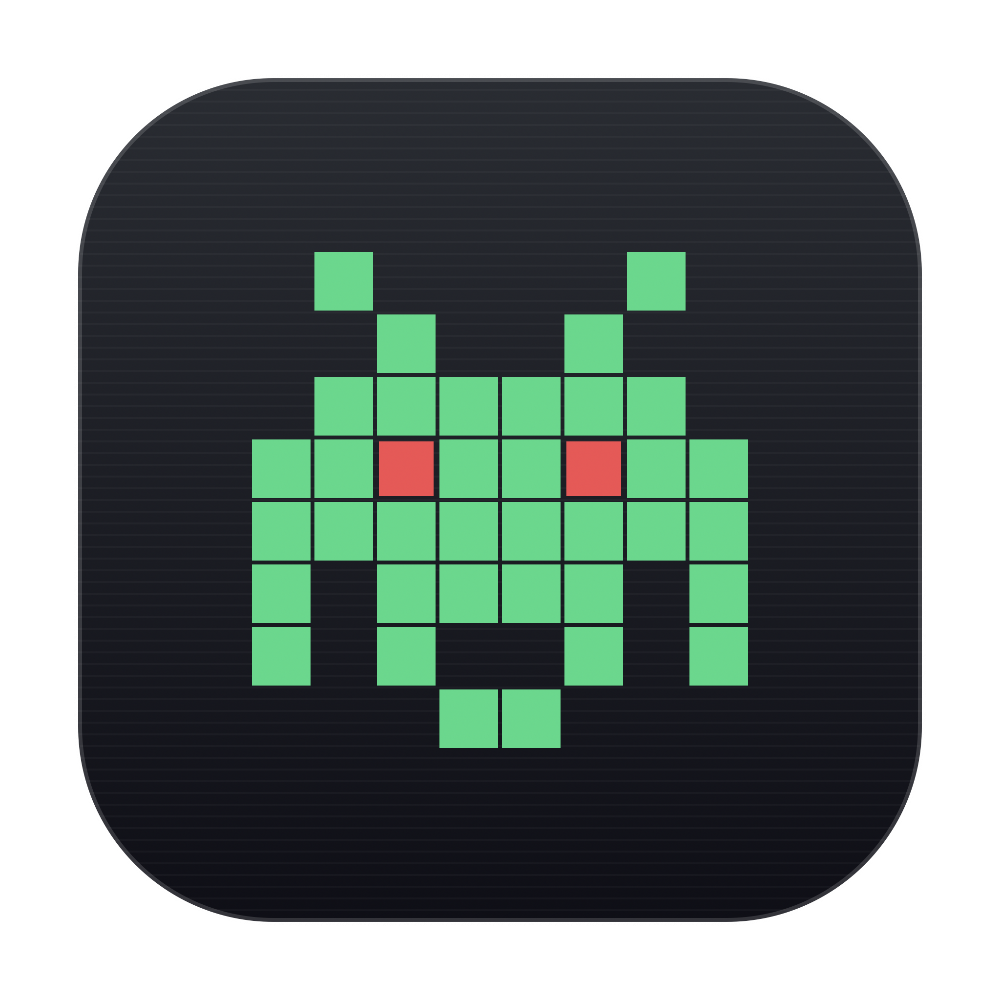

<div align="center">
  
  <h1>SlopMonster for macOS</h1>
  <p><b>Native desktop app & menu-bar companion to detect and eliminate AI tells & hollow prose</b></p>

  [](https://github.com/chrollovale/SlopMonsterMac/releases/latest)
  [](https://github.com/chrollovale/SlopMonsterMac)
  [](https://swift.org)
  [](./LICENSE)

  <br />
  <a href="https://github.com/chrollovale/SlopMonsterMac/releases/latest"><b>📥 Download SlopMonster for macOS (.zip)</b></a>
</div>

---

A native, high-performance macOS desktop application and companion menu-bar system designed to detect and eradicate Large Language Model (AI) tells, robotic rhythms, and hollow prose from drafts.

Inspired by [ItsssssJack/SlopMonster](https://github.com/ItsssssJack/SlopMonster), completely re-engineered in pure Swift & SwiftUI with on-device NaturalLanguage analysis, interactive word-level diffs, and multi-provider rival model cleansing (Local Ollama + Anthropic Claude 3.5).

---

## Features

- **Full Native macOS Application**: Standard macOS window with split-pane editor, diagnostics inspector, diff viewer, batch scanner, and native preferences.
- **Rival Model Cleanse Engine**:
  - **100% Private Local AI**: Direct integration with [Ollama](https://ollama.ai) (`llama3.2`, `mistral`, `deepseek-r1`, `qwen2.5`) on Apple Silicon.
  - **NVIDIA NIM (Nemotron Ultra & Super)**: Direct support for `nvidia/llama-3.1-nemotron-70b-instruct` and Nemotron 4 via `https://integrate.api.nvidia.com/v1`.
  - **Anthropic Claude 3.5 Sonnet / Haiku**: Direct API integration with secure local Keychain key storage and structured JSON output.
  - **Apple MLX / Local Engine**: Configurable local server endpoints.
- **Enhanced Linter Engine**:
  - Catches the classic 5 SlopMonster categories (Vocab, Phrases, Punctuation, Tricolons, Proof).
  - **Cadence & Burstiness Metric**: Uses Apple's `NaturalLanguage.framework` to detect robotic, uniform sentence lengths ($CV < 0.24$).
  - **Slop Density Index (SDI)**: Granular tells-per-100-words metric alongside the classic 5/5 rubber stamp.
- **Retro Mac OS Aesthetics**:
  - Tactile pixel-art monster mascot with animated expressions (clean, suspicious, alarmed, cleansing).
  - Classic System 7 / NeXT rubber stamp indicator (`[ 5/5 CLEAN ]` vs `[ 2/5 SLOPPY ]`).
  - Vintage LED segment meter.
  - Optional typewriter & retro Mac chimes for auditory feedback.
  - Optional subtle CRT scanline overlay.
- **Companion Menu Bar Extra**:
  - Quick-access menu bar icon to deslop clipboard copy directly without switching windows.
- **Batch Project Scanner**:
  - Drag and drop Markdown (`.md`) or HTML files/folders to audit entire project documentation repositories.

---

## Quick Start

### 1. Launch the Application
You can directly open the pre-built application bundle:

```bash
open SlopMonster.app
```

Or run the build script:

```bash
./build_app.sh
```

### 2. Configure Cleanse Provider (Preferences `⌘,`)
- **To use Local AI (Free & Offline)**:
  1. Ensure Ollama is running: `ollama serve`
  2. Pull your model of choice: `ollama pull llama3.2`
  3. In SlopMonster Preferences, select **Local Ollama** and click **Test Connection**.
- **To use Anthropic Claude**:
  1. Select **Anthropic Claude 3.5 Sonnet** in Preferences.
  2. Enter your Anthropic API Key (stored in macOS Keychain/UserDefaults).

### 3. Run Automated Regression Tests
To run the full test suite verifying regex rules, literal exclusions, tricolon filters, and diff algorithms:

```bash
DEVELOPER_DIR=/Applications/Xcode.app/Contents/Developer swift test
```

---

## Project Structure

```
SlopMonsterMac/
├── Package.swift                    # Swift Package Manager specification
├── build_app.sh                     # Release build & app bundler script
├── SlopMonster.app/                 # Complete launchable macOS application bundle
│   └── Contents/
│       ├── MacOS/SlopMonster        # Compiled release executable
│       ├── Resources/AppIcon.icns   # Retro Pixel Monster App Icon
│       └── Info.plist               # App metadata
├── Sources/SlopMonsterMac/
│   ├── App/
│   │   └── SlopMonsterApp.swift     # @main SwiftUI App & MenuBarExtra
│   ├── Engine/
│   │   ├── SlopEngine.swift         # NLP & Regex detection engine
│   │   ├── CleanseService.swift     # Multi-model client (Ollama + Claude)
│   │   ├── DiffEngine.swift         # LCS Word-level diff generator
│   │   └── TextNormalizer.swift     # Markdown & HTML AST prose strippers
│   ├── Models/
│   │   ├── SlopReport.swift         # Data structures & scoring metrics
│   │   └── AppSettings.swift        # User configurations & keychain
│   └── Views/
│       ├── MainWindowView.swift     # Primary workspace window (Studio split-pane)
│       ├── DiagnosticsView.swift    # Rules, tell inspector & editorial advice
│       ├── DiffView.swift           # Side-by-side / inline revision diff
│       ├── BatchScannerView.swift   # Drag & drop project document auditor
│       ├── RetroControls.swift      # Pixel mascot, rubber stamp & LED meter
│       └── SettingsView.swift       # Preferences pane (Ollama / Claude keys)
└── Tests/
    └── SlopMonsterMacTests/
        └── SlopMonsterMacTests.swift # 8 core regression tests
```

---

## License

MIT License. Inspired by [ItsssssJack/SlopMonster](https://github.com/ItsssssJack/SlopMonster).

---

### ⭐ Support the Project
If SlopMonster helped polish your writing or detect AI tells, please consider giving it a **Star** on GitHub!
